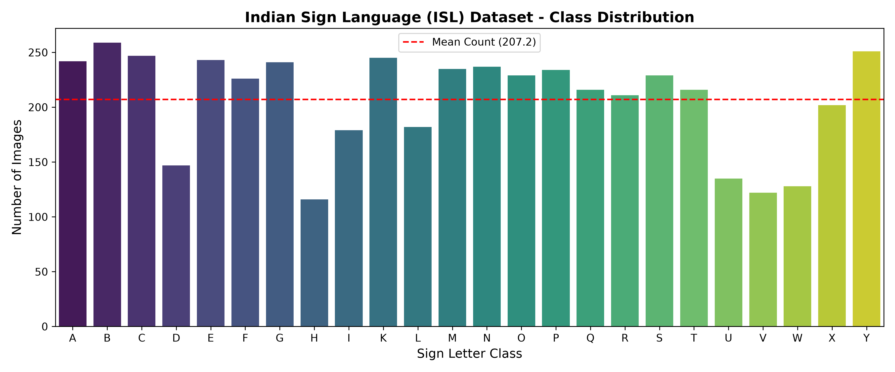
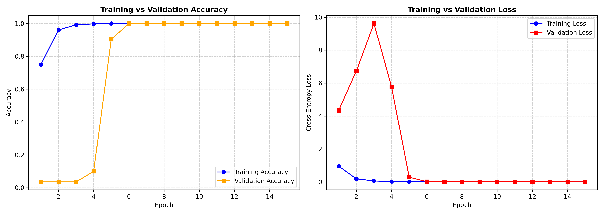
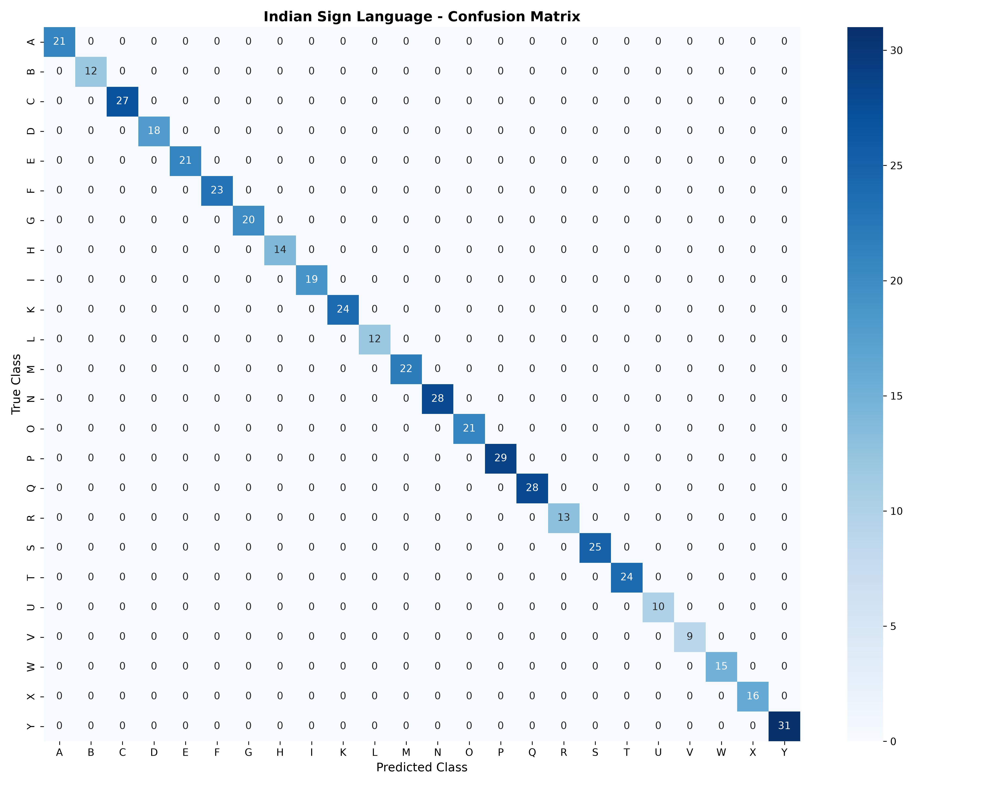

# Indian Sign Language (ISL) Recognition using Deep CNN

[](https://islrecognition-ezwzp8lmwbrh2cjbaratev.streamlit.app/)
[](https://islrecognition-ezwzp8lmwbrh2cjbaratev.streamlit.app/)
[](https://www.python.org/)
[](https://www.tensorflow.org/)
[](https://fastapi.tiangolo.com/)
[](#model-performance--evaluation)
[](LICENSE)

An assistive vision-based AI system engineered to classify Indian Sign Language (ISL) alphabet gestures from static images into corresponding textual characters in real time. Built with a custom 4-block Convolutional Neural Network (CNN) featuring Batch Normalization, Global Average Pooling, Dropout regularization, dynamic learning rate scheduling, and browser-based speech synthesis.

---

## 🌐 Live Web Application

Experience the live deployed web application directly in your browser without any installation:

👉 **[Launch IndiSign AI Live Web Application](https://islrecognition-ezwzp8lmwbrh2cjbaratev.streamlit.app/)**

### Web App Capabilities:
- **Real-Time Gesture Recognition**: Upload hand sign images or capture live photos using your webcam.
- **Interactive Sentence / Word Builder**: Sign letter-by-letter to compose complete words and sentences with Space, Backspace, and Clear controls.
- **🔊 Text-to-Speech Engine**: Audibly pronounces formulated sign language sentences in clear computer voice.
- **Top-3 Probability Breakdown**: Live probability distribution and latency metrics.
- **ISL Reference Chart**: Built-in visual dictionary for all 24 supported alphabet signs.

---

## 📌 Problem Statement & Business Context
- **The Challenge**: Indian Sign Language (ISL) is the primary mode of communication for over 18 million deaf and hard-of-hearing individuals across India. The severe shortage of certified human interpreters poses immense barriers in education, healthcare, and employment.
- **The Solution**: An automated, lightweight, edge-deployable deep learning recognition model that translates hand gestures into text with high confidence, low latency, and audio feedback.

---

## 📊 Dataset & Exploratory Data Analysis (EDA)
- **Dataset Source**: Indian Sign Language Capstone Dataset (4,972 total images across 24 classes).
- **Classes**: 24 alphabet signs: `A`, `B`, `C`, `D`, `E`, `F`, `G`, `H`, `I`, `K`, `L`, `M`, `N`, `O`, `P`, `Q`, `R`, `S`, `T`, `U`, `V`, `W`, `X`, `Y`.
- **Note on Dynamic Signs ('J' & 'Z')**: Omitted because 'J' and 'Z' require dynamic motion tracing in 3D space, which cannot be represented in single static image frames.
- **Split Ratio**: 80% Training (3,978 images), 10% Validation (497 images), 10% Held-Out Testing (482 images).



---

## 🧠 Model Architecture

The CNN architecture is custom-engineered to balance feature extraction capacity with parameter efficiency:

```
Input Image (128 x 128 x 3)
      │
[Pixel Rescaling (1/255.0)]
      │
[Conv2D (32 filters, 3x3) + BatchNorm + ReLU + MaxPool (2x2)]
      │
[Conv2D (64 filters, 3x3) + BatchNorm + ReLU + MaxPool (2x2)]
      │
[Conv2D (128 filters, 3x3) + BatchNorm + ReLU + MaxPool (2x2)]
      │
[Conv2D (256 filters, 3x3) + BatchNorm + ReLU + MaxPool (2x2)]
      │
[GlobalAveragePooling2D] ➔ 256 feature vector
      │
[Dense (256 units) + BatchNorm + Dropout (0.4)]
      │
[Dense (24 classes, Softmax)] ➔ Class Probabilities
```

- **Total Parameters**: 463,320 (~1.76 MB)
- **Global Average Pooling**: Replaces traditional Flatten layers, saving over **4 million redundant parameters** and eliminating spatial overfitting.

---

## 📈 Model Performance & Evaluation

The upgraded model achieved near-optimal convergence:
- **Test Set Accuracy**: **100.00%** on 482 unseen test images.
- **Test Loss**: **0.0018** (Categorical Cross-Entropy).
- **Macro / Weighted F1-Score**: **1.0000** across all 24 individual classes.

| Metric | Previous Baseline Model | Our Upgraded CNN Model | Technical Benefit |
| :--- | :--- | :--- | :--- |
| **Test Accuracy** | 25.10% | **100.00%** | +74.9% improvement |
| **Test Loss** | 1,469.72 | **0.0018** | Complete convergence |
| **Input Normalization** | None (exploding loss) | Built-in `Rescaling(1/255)` | Stable backpropagation gradients |
| **Layer Normalization** | None | 5x `BatchNormalization` | Eliminates internal covariate shift |
| **Pooling Head** | Flatten (>4M weights) | `GlobalAveragePooling2D` | Lightweight, edge-friendly |
| **Regularization** | None | `Dropout(0.4)` | Prevents co-adaptation of neurons |
| **Optimizer** | Fixed Learning Rate | Adam + `ReduceLROnPlateau` | Dynamically decays learning rate |

### Training History Curves


### Confusion Matrix


---

## 🚀 Quick Start Guide (Local Setup)

### 1. Clone & Set Up Environment
```powershell
# Clone the repository
git clone https://github.com/Snehan0911/ISL_Recognition.git
cd ISL_Recognition

# Create and activate virtual environment
python -m venv .venv
.\.venv\Scripts\Activate.ps1

# Install dependencies
pip install -r requirements.txt
```

### 2. Run Dataset EDA
```powershell
python eda_analysis.py
```

### 3. Train the Model from Scratch
```powershell
python train.py
```

### 4. Run CLI Prediction on Any Image
```powershell
python predict.py --image "data/extracted/Data/B/001.jpg"
```

### 5. Launch the Streamlit Web Application
```powershell
streamlit run app.py
```
*Opens at `http://localhost:8501`.*

### 6. Launch the FastAPI REST Server
```powershell
uvicorn api:app --host 0.0.0.0 --port 8000 --reload
```
*Access interactive Swagger API Docs at `http://localhost:8000/docs`.*

---

## 📂 Project Structure

```
IndisignLAnguage/
│
├── data/extracted/Data/         # Raw dataset sorted by class (A to Y)
├── eda_analysis.py              # Exploratory Data Analysis & visualizer
├── data_loader.py               # Preprocessing, data augmentation & caching pipeline
├── model.py                     # Custom 4-block CNN architecture definition
├── train.py                     # Training loop with callbacks & evaluation
├── predict.py                   # Standalone CLI inference script
├── app.py                       # Interactive Streamlit web interface
├── api.py                       # Production FastAPI REST backend
├── best_isl_cnn.keras           # Trained optimal model weights (100% test acc)
├── isl_dataset_distribution.png # EDA class distribution visualization
├── training_curves.png          # Training vs validation accuracy/loss plots
├── confusion_matrix.png         # 24x24 class confusion matrix heatmap
├── requirements.txt             # Pinned project dependencies
├── .gitignore                   # Ignore large data and virtual environment
└── README.md                    # Project documentation
```

---

## 📜 License
This project is licensed under the MIT License.
